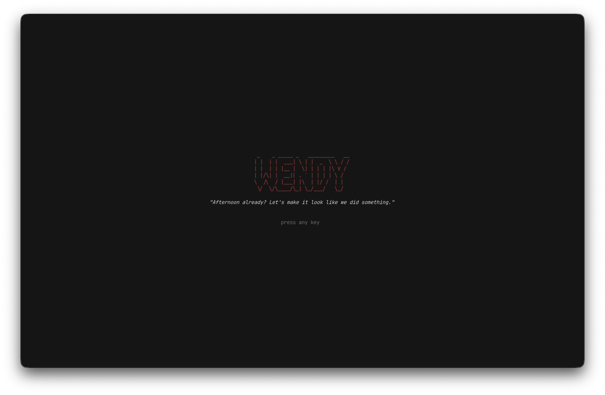

# Wendy



A terminal TUI for launching your stuff.

## Run

```
python3 main.py
```

No installs needed — `curses` is built into Python on macOS.

## Menu

- **Modes** — pick one and Wendy runs it in this terminal (e.g. `claude`). When it exits, press enter to go back to Wendy.
- **Jobs** — saved bash commands, run now or daily.
- **Script Toggles** — bash scripts you switch on/off: **Firefox** (theme switcher) and **GitHub daily push** (toggle the daily commit).

## Modes

Modes live in `settings.json` as `"name": "shell command"`:

```json
"modes": {
  "Claude": "claude",
  "Claude (resume last)": "claude --continue",
  "Shell": "$SHELL"
}
```

Add your own, e.g. `"Server": "cd ~/SharedComputing && ./run.sh"`.

## Jobs

Saved bash commands (e.g. a daily git push). In the Jobs screen:

| key   | does                                         |
| ----- | -------------------------------------------- |
| enter | run the job now                              |
| n     | new job — name, command, daily time (HH:MM)  |
| t     | change a job's time (empty = manual only)    |
| l     | view the job's log                           |
| d     | delete                                       |

Jobs with a time are scheduled in your `crontab` (Wendy only touches its own
`# >>> wendy jobs >>>` block). Each run is logged to `~/.wendy/logs/<job>.log`,
and the Jobs screen shows the last run and whether it failed.

Note: cron only runs while the Mac is awake.

## Firefox themes

`scripts/firefox-theme.sh` switches your Minecraft Firefox themes. Wendy runs it from **Script Toggles → Firefox**:

| item            | does                                          |
| --------------- | --------------------------------------------- |
| Random theme    | picks nether or overworld, then opens Firefox |
| Nether theme    | nether theme on                               |
| Overworld theme | overworld theme on                            |
| Theme off       | back to normal Firefox                        |
| Status          | shows which theme is on                       |

Firefox only loads the theme when it starts, so restart Firefox (⌘Q) after switching.
Theme files are read from `~/Documents/firefox-chrome-backup/chrome`
(change with `WENDY_FIREFOX_THEMES=/other/path`).

## GitHub daily push

`scripts/daily-push.sh` toggles the daily commit from your `workflows` repo
(`~/workflows`, its LaunchAgent `com.twosquaredhoon.workflows.dailypush`).
Wendy runs it from **Script Toggles → GitHub daily push**:

| item     | does                                             |
| -------- | ------------------------------------------------ |
| Turn on  | load the LaunchAgent (runs at login + every hour) |
| Turn off | unload it                                        |
| Status   | on/off, last entries in `daily.md`, last run     |
| Push now | run `daily_push.sh` right now                    |
| View log | open `launchd.out.log`                           |

## Structure

```
main.py                 # entry point — the TUI
settings.json           # modes, jobs
config/
├── welcome.py          # welcome screen (logo + greeting) on launch
├── modes.py            # Modes screen — runs commands
├── jobs.py             # Jobs screen — saved/scheduled bash commands
├── config_menu.py      # Script Toggles screen (Firefox, GitHub daily push)
├── firefox.py          # Script Toggles → Firefox: theme switcher items
├── github.py           # Script Toggles → GitHub daily push items
├── menu_list.py        # shared list screen used by Script Toggles
├── palette.py          # colors
└── settings_store.py   # load / save settings.json
scripts/
├── firefox-theme.sh    # nether | overworld | random | off | status
└── daily-push.sh       # on | off | status | now | log
documentation/          # per-file notes
```

## License

MIT
